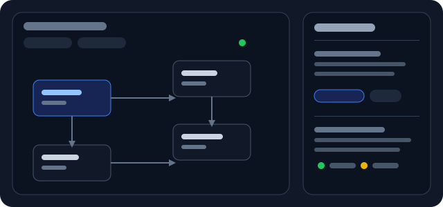

# Architecture map

English | [中文](README.zh.md)

**中文名：架构地图** · An architecture workbench for DeepSeek Harness: a live semantic architecture graph, per-node side conversations, and incremental architecture memory.

> Status: **pre-alpha, working skeleton.** The Host tools, sidebar canvas, local node positions, architecture memory, per-node discussions, deterministic exports and built-in Mermaid rendering work today. Shared positions and release polish are next. Design notes are kept locally and intentionally not tracked.

---

## Why

Agents can already read a repository and draw a diagram. The diagram is dead:

- you cannot click a node and ask about it;
- every regeneration renames and re-lays-out everything, so last week's "N3" is gone;
- discussing one module means polluting the main conversation or starting a fresh session that forgot everything;
- the next session re-reads the whole repository because nothing was remembered.

Architecture map makes the architecture a **first-class, addressable object** in the harness:

- the agent builds a **semantic graph** (stable ids, code anchors, status);
- you view it on an interactive canvas in the right sidebar;
- each node can open an **isolated side conversation** that inherits the main conversation's memory;
- side conversations merge their edits back into the one canonical graph;
- an **architecture dossier** makes later analysis incremental — only changed files are re-read.

## What it looks like



A static feature preview is included. A recorded 30-second demo GIF is not part of this repository yet.

```
┌──────────────── main conversation ────────────────┬──────── right sidebar ────────┐
│  you: draw the architecture of this project       │  [Graph]  [n3 · discuss]  [+] │
│  agent: 14 nodes, 19 edges — see the map        │   ┌────┐      ┌────┐          │
│                                                   │   │ n1 │─────▶│ n3 │          │
│  (conversation stays clean while you discuss)     │   └────┘      └────┘          │
│                                                   │  n3 · Session Store           │
│                                                   │  summary / anchors / edges    │
│                                                   │  [lite] [fork]                │
└───────────────────────────────────────────────────┴───────────────────────────────┘
```

## Features (implemented today)

- **Canonical architecture graph** — `.archmap/graph.json` with a revision number, schema validation, atomic writes and a one-step backup. The model reads and edits it through `arch_graph_get` / `arch_graph_patch`; `apply:false` previews without writing.
- **Right-sidebar canvas** — reads the graph from the session workspace, renders nodes/edges as SVG with a layered (longest-path) layout, supports pan, wheel zoom, `Fit`, node dragging and `Reset layout`, and shows node details on click.
- **Local layout memory** — dragged node positions are kept per workspace in browser storage, so a refresh or a new session on the same machine keeps the layout. `Reset layout` clears it. Shared positions are planned.
- **Incremental architecture memory with cosmetic detection** — `.archmap/manifest.json` records content hashes plus a normalized code signature; `arch_sync` reports only added/changed/deleted files, distinguishes code changes from format/comment-only changes, and lists the nodes whose anchors are affected. `markStale:true` marks those nodes stale (and bumps the graph rev); the default is report-only. Anchors may also store the file's normalized content signature; sync reports a node whose anchor hash no longer matches, and `arch_graph_patch` fills missing hashes or refreshes them with `refreshAnchors:true` after review. `arch_manifest_commit` records analyzed files, and `arch_doc_get` / `arch_doc_put` read and write `overview`, `modules/<id>` and `notes/<id>`.
- **Deterministic exports** — `arch_export` writes Mermaid flowchart source, a standalone SVG, or a Markdown dossier digest to `.archmap/export/`; graph revision and files stay unchanged.
- **Built-in Mermaid rendering** — assistant ` ```mermaid ` fences render with a vendored Mermaid 12.2.0 runtime served from the plugin's own Host route. No CDN and no `dsh-mermaid-plus` dependency. Streaming keeps the code block; parse errors fall back to code plus an error line. `renderMermaid: false` disables it.
- **Per-node side conversations** — `arch_discuss` starts a child for `node:<id>` or `edge:<id>`: `fork` inherits the main conversation's completed turns; `lite` starts fresh with the graph and dossier. Delivery is caller-only, so the main conversation is not polluted; conclusions go to `notes/<id>`. The node detail also has `Discuss (fork)` / `Lite` buttons that open the child in the right sidebar through the `subagentchat` resource. Discussion children are prompt-constrained; shell and generic source-write calls are denied at execution (inherited tool schemas may remain visible in a fork). Graph changes still require approval.

## Planned next

- Shared/persisted positions, direct export buttons in the panel, and release polish (CI, packaging, GIF).

## What it is not

- Not a general whiteboard (Excalidraw-style). No freehand pixels; every element is addressable.
- Not a general memory plugin. The dossier exists to complete the architecture graph, not to store all conversation memory.
- Not just a diagram generator. The graph, discussions, merges, and memory are one loop.

## Dependencies

No runtime plugin dependencies beyond DSH itself:

| Feature | Extra plugin? |
|---|---|
| Canvas, graph storage, local positions | No — implemented in this bundle |
| Skill / bootstrap guidance | No — bundled `architecture-map` skill |
| Architecture memory (`arch_sync` + dossier) | No — workspace files managed by this plugin |
| Mermaid rendering | No — Mermaid 12.2.0 is vendored and served locally; `renderMermaid: auto/on/off` |
| Side conversations | No — `arch_discuss` plus sidebar `Discuss` buttons |
| Stale detection | No — `arch_sync` with `markStale:true` |
| Export (Mermaid/SVG/Markdown) | No — `arch_export` |
| Sharper call/impact edges | Optional: `dsh-plugin-codegraph` (recommended, **not installed automatically**) |

## Mermaid rendering

Assistant messages with a ` ```mermaid ` fence render as diagrams. The runtime is vendored at
`vendor/mermaid.esm.min.mjs` (Mermaid 12.2.0, MIT; ELK is EPL-2.0) and served by the Host at
`/x-dsh-architecture-map/vendor/mermaid.esm.min.mjs`; the browser never fetches a CDN. The client
checks `/x-dsh-architecture-map/config` first, so with `renderMermaid: off` fences stay plain
code blocks and the 5.2 MB runtime is not loaded. The default `auto` disables our renderer when
`dsh-mermaid-plus` (a known conflicting fence provider) is enabled; `on` forces it, `off` disables it.

```yaml
- insert:
    - id: architecture-map
      name: dsh-architecture-map
      config:
        renderMermaid: off
```

## How memory works (no extra plugin)

Architecture map keeps an architecture-specific dossier in the workspace, managed by the plugin itself:

```
.archmap/
├── graph.json        # canonical graph + rev
├── manifest.json     # path -> sha256 of analyzed files
├── overview.md       # one-page overview
├── modules/<id>.md   # per-module dossier
└── notes/<node>.md   # per-node discussion conclusions
```

- The first pass reads the repository once and writes the dossier + graph.
- Later, `arch_sync` hashes the workspace and returns only changed/added/deleted files and affected nodes. The agent reads only those, updates the dossier, then `arch_manifest_commit` records them.
- Conversation memory is separate: a `fork` side chat inherits the main conversation's completed turns through DSH's native fork; `lite` gets a dossier digest.
- This is **not** a general memory system and does **not** depend on `dsh-project-brain`, `dsh-living-memory`, or `dsh-memex`. Uninstall those and it still works.

## Optional companion (recommended)

- [dsh-plugin-codegraph](https://github.com/CC19990113/dsh-plugin-codegraph) — tree-sitter code intelligence (symbols, callers, impact). Recommended if you want sharper edges; **not required**. Upstream reports ~1s first index and ~45ms re-index on a 337-file workspace, so structural queries are cheap after the first build. It is type-free, so dynamic dispatch and member calls may stay unresolved and fall back to text search. On a small repo the first index can cost more than a few greps.

## Development

```bash
npm run check   # node --check for the Host/Client entry points
npm test        # node --test test
npm pack --dry-run
```

## Installation

Pre-alpha; the bundle is installed locally rather than from npm:

1. Install the bundle via **Plugins → Add plugin** (local directory) or add it as a `link:` dependency in the profile.
2. Restart DSH once after installing so the client half joins the browser boot graph.
3. Open a conversation.
4. Optional but recommended: install `dsh-plugin-codegraph` separately (`dsh plugin add dsh-plugin-codegraph`). It is **not bundled and not installed automatically**.

### Where to find it

There is no separate "start" button or left-sidebar icon. The plugin adds a right-sidebar panel and a slash command:

- Open the right sidebar and click **+** (add tab) → **Architecture map**.
- Or type `/arch` in the composer and pick **Architecture map**.
- To check the Host half, ask the agent to call `arch_hello`.

## Quick start

1. In a new conversation, ask: *"Use the architecture-map skill: sync this workspace, build or update the graph, and write the dossier."*
2. Open `/arch` and click **Reset layout** if the saved layout hides the new graph.
3. Click a node → **Discuss (fork)** for a context-aware discussion, or **Lite** for a cheap one.
4. After changing code, ask for `arch_sync`; review only the changed files, update the node/doc, then `arch_manifest_commit`.
5. Use `arch_export` for Mermaid/SVG/Markdown, or the **Mermaid** fence renderer for chat diagrams.

## Limitations

- The sidebar follows the **session workspace**; an explicit tool `workspace` can point at a different graph than the panel shows.
- Node positions are stored in the browser locally, not in `graph.json`.
- Fork discussions inherit the parent request prefix, so their tool schemas may still show `bash`/`write` even though calls are denied.
- A parent-initiated `send_message` to a discussion child produces DSH's native settlement notice (including the child's closing text) in the parent conversation. The initial `arch_discuss` is caller-only and the child's full transcript never enters the main log; use the child's sidebar chat for narrative follow-ups.
- The canvas is hand-written SVG with a layered layout, not React Flow.
- Mermaid rendering is on by default (`auto`) but can be disabled with `renderMermaid: off`; a known `dsh-mermaid-plus` installation makes `auto` disable ours.
- This is pre-alpha; the API and file schema can still change.

## FAQ

**Do I need `dsh-mermaid-plus`?** No. Mermaid 12.2.0 is vendored. With `dsh-mermaid-plus` enabled,
`renderMermaid: auto` disables our renderer to avoid the shared `mermaid` fence key; `on` forces ours.

**Why hand-written SVG instead of React Flow?** It keeps the client bundle self-contained and avoids a
build/dependency chain. The layered layout covers the current graph sizes; React Flow remains an optional upgrade.

**Why does the sidebar show a different graph than a tool's `workspace` argument?** The panel follows the
session workspace by design. Open a session whose workspace is the graph you want to see.

**fork or lite?** `fork` inherits the parent's completed turns; `lite` starts from the graph and dossier only.

**Is this a general memory plugin?** No. The dossier is only for this architecture graph.

**How do I disable Mermaid?** Set `renderMermaid: off` in the bundle config; fences remain code blocks and the runtime is not loaded.

**Do I need codegraph?** No. `dsh-plugin-codegraph` is an optional companion for sharper call/impact edges.

## Requirements

- DeepSeek Harness with a Web/Desktop host. Verified with DSH `0.2.2-rc.5` on macOS; the Host/client APIs may change in later releases.
- Node.js 22+ for the test suite and CI.
- A workspace the agent can read.
- Mermaid is vendored; no separate Mermaid plugin is required.

## Roadmap

| Version | Scope |
|---|---|
| 0.1 | graph core and tools, sidebar canvas, node dragging, local position memory, `arch_sync` + manifest + dossier docs, cosmetic diff + stale marking, bundled architecture skill, `arch_discuss`, sidebar discussion buttons, `arch_export`, built-in Mermaid fence rendering |
| 0.2 | shared/persisted positions, direct export buttons, release polish |
| 0.3 | direct node→discussion bridge, shared/persisted positions, proposals, graph diff |
| 0.4 | edge discussions, group collapse, Mermaid import, Office export |
| 0.5 | multiple graphs, PR links, shared team maps |

## Prior art & acknowledgements

This space already has excellent DSH plugins. Architecture map builds on their ideas and, where stated, their MIT-licensed code:

| Project | What we take |
|---|---|
| [dsh-mermaid-plus](https://github.com/pidongqianqian/dsh-mermaid-plus) (MIT) | The built-in Mermaid fence renderer and vendored runtime are adapted from it; original copyright notices are retained. |
| [@eduwork/dsh-side-chat](https://github.com/ECNU/EduWork/tree/main/packages/dsh-side-chat) (MIT/MulanPSL-2.0) | UX reference for native seed-fork side chats and hiding inherited messages. |
| [@ahggg/dsh-side-chat](https://github.com/AHGGG/dsh-side-chat) (MIT) | Codex-style side-chat interaction reference. |
| [dsh-project-brain](https://github.com/yj-liuzepeng/dsh-project-brain) (MIT) | Prior art for project memory; our dossier is architecture-specific, not a general memory. |
| [dsh-anatomy](https://github.com/h2298511604-ops/dsh-anatomy) (MIT) | Live architecture-map UI reference (targets DSH itself). |
| [dsh-diagram-gallery](https://www.npmjs.com/package/dsh-diagram-gallery) (MIT) | Diagram generation/gallery reference. |
| [dsh-mindmap-live](https://github.com/SSShooter/dsh-mindmap-live) (MIT) | Bidirectional agent/user editing reference. |
| [dsh-plugin-codegraph](https://github.com/CC19990113/dsh-plugin-codegraph) (MIT) | Optional code-fact companion. |

Copied or adapted code keeps its original license header and is listed in [`THIRD_PARTY_NOTICES.md`](THIRD_PARTY_NOTICES.md).

## Design notes

Design and construction notes are kept locally and intentionally not tracked. The tracked README is the public overview; implementation details live in the local `docs/` folder.

## License

MIT.
