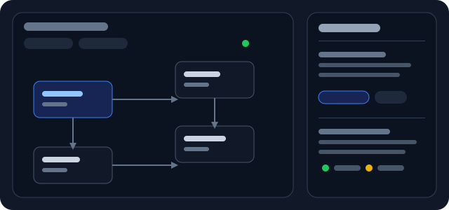

# Architecture map · 架构地图

[English](README.md) | 中文

**DeepSeek Harness 的架构工作台：可交互的语义架构图、按节点开启的侧栏子对话、增量架构记忆。**

> 状态：**0.2.1 开发者预览**。Host 工具、右侧栏画布、架构记忆、按节点子对话、确定性导出、内置 Mermaid 渲染和通过 SSH 只读查看远程 Linux 仓库都已可用；共享位置仍待实现，空闲父会话自动维护和 pending 清零是已知粗糙边缘。

---

## 为什么

agent 已经能读仓库、画图，但那张图是死的：

- 不能点节点追问；
- 每次重新生成，命名和布局都会漂移，上次的「N3」找不到了；
- 讨论一个模块，要么污染主对话，要么开新会话把上下文全丢掉；
- 下一个会话又把代码从头读一遍，什么都没有沉淀。

Architecture map 把「项目架构」变成 harness 里**可寻址的一等对象**：

- agent 建**语义图**（稳定 id、代码锚点、状态）；
- 用户在右侧栏的交互画布上看图；
- 每个节点可以开一个**隔离的侧栏子对话**，继承主对话的记忆；
- 子对话的修改合并回唯一的图；
- **架构档案**让后续分析只处理变更文件。

## 界面示意



仓库包含静态功能预览；30 秒演示 GIF 尚未录制。

```
┌──────────────── 主对话 ───────────────────────────┬──────── 右侧栏 ──────────────┐
│  你：画一下这个项目的架构图                        │  [架构图]  [n3 · 讨论]   [+]  │
│  agent：14 个节点、19 条边，看右侧                 │   ┌────┐      ┌────┐         │
│                                                   │   │ n1 │─────▶│ n3 │         │
│  （你讨论时，主对话保持干净）                      │   └────┘      └────┘         │
│                                                   │  n3 · Session Store          │
│                                                   │  摘要 / 锚点 / 上下游          │
│                                                   │  [轻讨论] [深讨论]            │
└───────────────────────────────────────────────────┴──────────────────────────────┘
```

## 已实现

- **Canonical 架构图**：`.archmap/graph.json`，带 rev、schema 校验、原子写入和单步备份。模型通过 `arch_graph_get` / `arch_graph_patch` 读写；`apply:false` 只预览不写入。
- **右侧栏画布**：从当前会话 workspace 读取图，SVG 渲染节点/边，使用 longest-path 分层布局，支持平移、滚轮缩放、`Fit`、节点拖拽、`Reset layout`，点击节点看详情。
- **位置本地记忆**：只保留拖动过的节点位置，按 workspace 存在浏览器本地；其余节点继续跟随自动布局，图变化后会重新分层。`Reset layout` 清掉本地覆盖。共享位置是后续计划。
- **增量架构记忆 + 格式改动识别**：`.archmap/manifest.json` 记录 hash 和归一化代码签名；`arch_sync` 只报告新增/修改/删除文件，区分代码改动和仅格式/注释改动，并列出受影响节点；`markStale:true` 会把这些节点标成 stale 并递增 graph rev，默认只报告不写图；anchor 还可以存文件的归一化内容签名，sync 会发现 hash 不匹配的节点，复盘后用 `arch_graph_patch` 的 `refreshAnchors:true` 刷新；`arch_manifest_commit` 记录已分析文件；`arch_doc_get` / `arch_doc_put` 读写 `overview`、`modules/<id>`、`notes/<id>`。
- **确定性导出**：`arch_export` 把 Mermaid flowchart、独立 SVG 或 Markdown 档案摘要写到 `.archmap/export/`；不改变 graph rev，也不改源文件。
- **内置 Mermaid 渲染**：assistant 消息里的 ` ```mermaid ` 块用 vendored Mermaid 12.2.0 渲染，runtime 由本插件 Host 路由提供，不依赖 CDN，也不依赖 `dsh-mermaid-plus`。流式时保留代码块，语法错误回退代码块 + 错误行；`renderMermaid:false` 可关闭。
- **按节点子对话**：`arch_discuss` 为 `node:<id>` 或 `edge:<id>` 开子会话；`fork` 继承主对话已完成轮次，`lite` 只靠图和档案。结果只走 caller，不污染主对话；结论写进 `notes/<id>`。节点详情里还有 `Discuss (fork)` / `Lite` 按钮，通过 `subagentchat` resource 在右侧栏打开子会话。子会话受提示词约束；shell 和通用源码写调用在执行时会被拒绝（fork 可能仍显示继承的工具 schema）；改图仍需你确认。
- **远程 Linux 仓库（开发者预览）**：`arch_remote_list/status/tree/read/grep` 通过 SSH 查看已登记仓库，不 clone；读内容前要授权，远程 `arch_sync`/`arch_manifest_commit` 只哈希已分析文件，变更轮询和 `/arch remote ...` 命令可用，面板可切换本地/远程来源，图和档案留在 `.archmap/projects/<id>/`，远程文件不被修改。

## 下一步计划

- 位置共享/写回图数据、右侧栏导出按钮、短视频演示（GIF）。
- 远程维护打磨：空闲父会话自动启动，维护后清零本地 pending。

## 不是什么

- 不是通用白板（Excalidraw 型）：没有自由像素，每个元素都可寻址。
- 不是通用记忆插件：档案是为了完善这张架构图，不是保存所有对话记忆。
- 不只是画图工具：图、讨论、合并、记忆是一个闭环。

## 依赖

除 DSH 本身外，没有运行时插件依赖：

| 功能 | 需要额外插件? |
|---|---|
| 画布、图存储、位置本地记忆 | 不需要——本 bundle 已实现 |
| Skill / bootstrap 指导 | 不需要——随包提供 `architecture-map` skill |
| 架构记忆（`arch_sync` + dossier） | 不需要——本插件管理的 workspace 文件 |
| Mermaid 渲染 | 不需要——Mermaid 12.2.0 已 vendored 并由本机路由提供；`renderMermaid: auto/on/off` |
| 侧栏子对话 | 不需要——`arch_discuss` + 右侧栏 `Discuss` 按钮 |
| Stale 检测 | 不需要——`arch_sync` 的 `markStale:true` |
| 导出（Mermaid/SVG/Markdown） | 不需要——`arch_export` |
| 更准的调用/影响边 | 可选：`dsh-plugin-codegraph`（推荐，**不默认安装**） |

## 数据存在哪里

架构图、manifest、档案和导出都在 `<workspace>/.archmap/`；插件安装目录只有代码、skill、vendor、文档和 locale。
插件不会修改用户项目的 `.gitignore`；想共享就提交 `.archmap/`，想只留本地就自己忽略。卸载插件不会删除
`.archmap/`。节点位置只存在浏览器本地，不属于图数据。

## 远程仓库（开发者预览）

插件可以通过你现有的 SSH 配置，映射一台远程 Linux 上的仓库，**不需要 clone**。读取是只读的，图和档案保存在本地工作区。

1. 用 `/arch remote add staging build-01 /srv/app` 登记远程项目（也可以手工写 `<workspace>/.archmap/index.json`）：

```json
{
  "schema": 1,
  "projects": [
    { "id": "local", "kind": "local", "dir": "." },
    {
      "id": "staging", "kind": "remote", "dir": "projects/staging",
      "transport": "ssh", "host": "build-01", "root": "/srv/app",
      "vcs": "git", "autoRefresh": true
    }
  ]
}
```

`host` 是你 SSH 配置里的 OpenSSH 目标；`root` 必须是远程绝对路径；非 git 目录把 `"vcs"` 设为 `"none"`。

2. 让 agent 用 `arch_remote_list`、`arch_remote_status`，再用 `arch_remote_tree` / `arch_remote_read` / `arch_remote_grep`。第一次读取内容会弹授权卡（本次会话 / 始终允许 / 拒绝）；回答前不会读取任何内容。

3. 图工具用 `workspace: "remote:staging"`；数据写在 `.archmap/projects/staging/` 下。远程文件永远不会被修改。
4. 打开 `/arch`，在面板顶部的来源选择器里切换 **本地 / staging**。状态条显示 host/root/vcs/授权；远程项目没有图时会显示对应的空状态。
5. 选中远程来源会开始轮询。`/arch remote sync staging` 立即检查一次，`/arch remote update staging` 启维护子会话，`/arch remote list` 列项目，`/arch remote grant/revoke/remove` 管理授权和登记。

自动维护只在“始终允许”后运行，最多 50 个变更文件、最多每 10 分钟一次；超限只标 stale。真远程端到端验收已在 Linux 主机上完成；父会话空闲时自动维护会跳过（可用 `/arch remote update` 强制），维护后本地 pending 计数暂未清零。

远程读取被限制在登记的 root 内：`..`、绝对路径逃逸和指向 root 外的符号链接都会被拒绝。git 项目用 HEAD + `git status`，并哈希已修改/未跟踪路径，保证脏文件再次编辑也能被检测到；非 git 项目用 path/size/mtime 元数据，只有已分析文件才会被哈希。

## 记忆是怎么做的（不需要其他插件）

Architecture map 在 workspace 里维护一份**架构专用档案**，由插件自己管理：

```
.archmap/
├── graph.json        # canonical 图 + rev
├── manifest.json     # 已分析文件的 path -> sha256
├── overview.md       # 1 页总览
├── modules/<id>.md   # 每模块档案
└── notes/<node>.md   # 每节点讨论结论
```

- 首次分析读一遍仓库，写出档案 + 图。
- 之后 `arch_sync` 对 workspace 做 hash 对比，只返回新增/修改/删除的文件和受影响节点；agent 只读这些文件，更新档案，再用 `arch_manifest_commit` 提交。
- 对话记忆是另一层：`fork` 子对话通过 DSH 原生 fork 继承主对话已完成轮次；`lite` 只拿档案摘要。
- 这**不是**通用记忆系统，也**不依赖** `dsh-project-brain`、`dsh-living-memory`、`dsh-memex`；卸掉它们照样工作。

## 可选增强（推荐）

- [dsh-plugin-codegraph](https://github.com/CC19990113/dsh-plugin-codegraph)：tree-sitter 代码智能（符号、调用、影响面）。想让连线更准可以装；**不装也能用**。上游报告 337 文件仓库首次索引约 1s、增量约 45ms，建好之后结构查询很便宜；但它是 type-free 解析，动态派发和成员调用可能解析不到，仍要 grep 兜底。小仓库首次索引可能比几次 grep 更贵。

## 开发

```bash
npm run check   # Host/Client 入口语法检查
npm test        # node --test
npm pack --dry-run
```

## 快速开始

1. 新会话里说：*“用 architecture-map skill 扫一遍这个 workspace，建/更新图并写档案。”*
2. 打开 `/arch`；如果保存的布局遮住了新节点，点 **重置布局**。
3. 点节点 → **讨论（fork）** 开继承上下文的讨论，或 **轻讨论** 开便宜版本。
4. 改代码后让 agent 调 `arch_sync`；只读变更文件，更新节点/档案，再 `arch_manifest_commit`。
5. 用 `arch_export` 导出 Mermaid/SVG/Markdown，或直接用聊天里的 Mermaid fence。

## 限制

- 右侧栏跟随**会话 workspace**；工具参数里的显式 `workspace` 可能和面板显示的图不同。
- 节点位置只存在浏览器本地，不在 `graph.json`。
- fork 讨论继承父对话 request prefix，工具列表里可能仍显示 `bash`/`write`，但执行层会拒绝。
- 父对话主动 `send_message` 给讨论子会话时，DSH 会在主对话里投递 native settlement notice（含子会话 closing text）。初次 `arch_discuss` 是 caller-only，子会话完整 transcript 不会进主日志；需要继续聊请在子会话侧栏里发。
- 画布是手写 SVG + 分层布局，不是 React Flow。带环的图会退化为紧凑网格；分层布局用于无环图。
- Mermaid 默认 `auto` 开启；`renderMermaid: off` 可关；检测到已知的 `dsh-mermaid-plus` 时 `auto` 会关闭本插件渲染。
- 这是 0.2.1 开发者预览，API 和文件 schema 仍可能变化。
- 远程仓库是开发者预览：登记、读取、同步、轮询、命令和维护都已接上，并在真实 Linux 主机上验收；空闲父会话的自动维护和 pending 清零仍是粗糙边缘。

## 安装

开发者预览；现在可安装本地 bundle，0.2.0 发布到 npm 后也可直接安装：

1. 通过 **Plugins → Add plugin**（本地目录）或插件管理器安装 bundle。
2. 安装后**重启一次 DSH**，让 Client 半进入浏览器 boot graph。
3. 打开一个会话。
4. 可选但推荐：单独安装 `dsh-plugin-codegraph`（`dsh plugin add dsh-plugin-codegraph`）。它**不随本插件打包，也不会自动安装**。

### 在哪里打开

它没有独立的“启动”按钮，也没有左侧栏图标；入口是右侧栏面板和斜杠命令：

- 打开右侧栏，点 **+**（添加 tab）→ **Architecture map**。
- 或者在输入框输入 `/arch`，选 **Architecture map**。
- 想单独验证 Host 半，让 agent 调用 `arch_hello`。

## 常见问题

**需要 `dsh-mermaid-plus` 吗？** 不需要，Mermaid 12.2.0 已 vendored。如果启用了 `dsh-mermaid-plus`，
`renderMermaid: auto` 会关闭本插件渲染，避免共用 `mermaid` fence key；`on` 强制开启本插件。

**为什么手写 SVG，不用 React Flow？** 保持 client bundle 自包含，不引入构建/依赖链。分层布局覆盖当前规模；
React Flow 仍可作为后续可选升级。

**为什么侧栏显示的图和工具 `workspace` 参数里的图不一样？** 面板按设计跟随会话 workspace。要看哪张图，
就打开 workspace 指向那个目录的会话。

**fork 和 lite 怎么选？** fork 继承主对话已完成轮次；lite 只从图和档案开始。

**这是通用记忆插件吗？** 不是，档案只服务这张架构图。

**怎么关闭 Mermaid？** 配置 `renderMermaid: off`；代码块保持不变，也不会加载 runtime。

**需要 codegraph 吗？** 不需要；`dsh-plugin-codegraph` 是可选的调用/影响边增强。

## 要求

- 带 Web/Desktop Host 的 DeepSeek Harness；在 macOS + DSH `0.2.2-rc.5` 上验证，后续版本 API 可能变化。
- 测试套件和 CI 需要 Node.js 22+。
- agent 可读的 workspace。
- Mermaid 已 vendored，不需要额外 Mermaid 插件。

## 路线图

| 版本 | 内容 |
|---|---|
| 0.1 | 图核心与工具、右侧栏画布、节点拖拽、位置本地记忆、`arch_sync` + manifest + dossier、格式改动识别 + stale、内置 architecture skill、`arch_discuss`、右侧栏讨论按钮、`arch_export`、内置 Mermaid fence 渲染 |
| 0.2 | 通过 SSH 只读查看远程 Linux 仓库（来源选择、授权、60 秒轮询、sync/命令、维护）+ 发布打磨 |
| 0.3 | 节点直连讨论、位置共享/写回图、提案、图 diff |
| 0.4 | 边讨论、分组折叠、Mermaid 导入、Office 导出 |
| 0.5 | 多图、PR 关联、团队共享 |
| 0.6 | 多远程仓库并行、远程共享/导出打磨 |

## 先例与致谢

这个方向已经有不少优秀的 DSH 插件。Architecture map 建立在它们的想法之上，并在注明的地方复用其 MIT 代码：

| 项目 | 我们借鉴/复用什么 |
|---|---|
| [dsh-mermaid-plus](https://github.com/pidongqianqian/dsh-mermaid-plus)（MIT） | 内置 Mermaid fence 渲染将参考它实现；保留原始版权声明。 |
| [@eduwork/dsh-side-chat](https://github.com/ECNU/EduWork/tree/main/packages/dsh-side-chat)（MIT/MulanPSL-2.0） | 原生 seed fork 侧聊、隐藏继承消息的 UX 参考。 |
| [@ahggg/dsh-side-chat](https://github.com/AHGGG/dsh-side-chat)（MIT） | Codex 式侧聊交互参考。 |
| [dsh-project-brain](https://github.com/yj-liuzepeng/dsh-project-brain)（MIT） | 项目记忆的先例；我们的档案只做架构专用，不做通用记忆。 |
| [dsh-anatomy](https://github.com/h2298511604-ops/dsh-anatomy)（MIT） | 实时架构图 UI 参考（对象是 DSH 本身）。 |
| [dsh-diagram-gallery](https://www.npmjs.com/package/dsh-diagram-gallery)（MIT） | 图生成/图表廊参考。 |
| [dsh-mindmap-live](https://github.com/SSShooter/dsh-mindmap-live)（MIT） | agent/用户双向编辑参考。 |
| [dsh-plugin-codegraph](https://github.com/CC19990113/dsh-plugin-codegraph)（MIT） | 可选的代码事实增强。 |

复制或改编的代码会保留原版权头，并在实现落地后登记到 [`THIRD_PARTY_NOTICES.md`](THIRD_PARTY_NOTICES.md)。

## 设计文档

远程设计与施工记录在 `docs/`；早期设计与施工笔记保留在本地并有意忽略。README 是公开概览。

## 许可

MIT。
