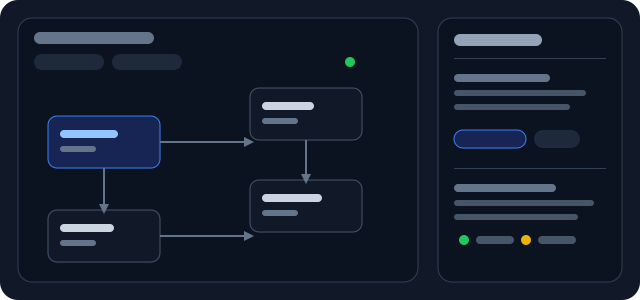

# Architecture map



A live, addressable architecture graph for DeepSeek Harness. The model writes nodes, edges and anchors into one canonical file; the right sidebar renders it; every node can open an isolated discussion with inherited conversation memory.

## What you get

- **Canonical graph** — `.archmap/graph.json` with a revision, schema validation, atomic writes and a one-step backup.
- **Right-sidebar canvas** — layered SVG layout with edge labels, `node.position` pins, pan/zoom/Fit, node dragging, reset layout and node details.
- **Architecture memory** — a manifest of analyzed files, incremental `arch_sync`, code-vs-cosmetic detection, stale marking and a Markdown dossier (`overview`, `modules/<id>`, `notes/<id>`).
- **Per-node discussions** — `arch_discuss` starts a fork (inherits completed turns) or lite (fresh from graph/dossier) child; the sidebar opens it; conclusions go to `notes/<id>`. The sidebar's Discuss/Lite buttons pass the selected local or remote source; a remote discussion requires remote content consent.
- **Exports** — deterministic Mermaid, SVG (pinned positions honored) and Markdown files under `.archmap/export/`.
- **Built-in Mermaid** — assistant ` ```mermaid ` fences render with a vendored runtime served by the plugin; no CDN and no extra Mermaid plugin.
- **Bundled skill** — `architecture-map` explains the sync → read → patch → dossier → commit loop.
- **Remote Linux repositories (developer preview)** — register a repository over SSH without cloning; the panel switches local/remote sources, content reads are consent-gated, and a 60-second fingerprint poll marks affected nodes stale while the graph/dossier stay local.

## Tools

| Tool | Purpose |
| --- | --- |
| `arch_hello` | Diagnostic activation check |
| `arch_graph_get` / `arch_graph_patch` | Read and batch-edit the graph (`apply:false` previews) |
| `arch_sync` | Full or incremental workspace comparison (`markStale` optional) |
| `arch_manifest_commit` | Record analyzed files in the manifest |
| `arch_doc_get` / `arch_doc_put` | Read/write the dossier |
| `arch_discuss` | Start a node/edge fork or lite discussion |
| `arch_export` | Write Mermaid/SVG/Markdown exports |
| `arch_remote_list` / `arch_remote_status` | List remote projects; metadata only, no consent needed |
| `arch_remote_tree` / `arch_remote_read` / `arch_remote_grep` | Consent-gated read-only remote inspection |

## Install and enable

Install the bundle in a DSH profile and enable the `architecture-map` row. The right sidebar gets an **Architecture map** tab. `/arch` opens it; the node detail has `Discuss (fork)` / `Lite`. Register a remote with `/arch remote add <id> <host> <path>`, then pick it in the panel source selector.

The model can also use the bundled `architecture-map` skill in a new session.

## Configuration

```yaml
- id: architecture-map
  name: dsh-architecture-map
  config:
    renderMermaid: auto
```

`renderMermaid: auto|on|off` controls the built-in renderer. `auto` disables it when the known conflicting `dsh-mermaid-plus` plugin is enabled; `off` also keeps fences as code blocks and does not load the 5.2 MB runtime.

## Data and permissions

- Reads/writes local state only under `<workspace>/.archmap/` (plus the browser's local drag overrides).
- No telemetry and no external network requests; Mermaid is served from the plugin's own Host route.
- Graph/dossier writes are bounded and atomic; source files are never edited by `arch_graph_patch` or `arch_doc_put`.
- Discussion children are prompt-constrained; shell and generic source-write calls are denied at execution (a fork may still display inherited tool schemas).
- Remote access uses the user's OpenSSH config, is read-only, and never clones or writes the remote repository. Content reads need an explicit grant: `/arch remote grant <id> session` (this session and its children, in memory) or `/arch remote grant <id> always` / no scope (workspace, persisted in `.archmap/index.json`, required for auto maintenance); `/arch remote revoke <id>` clears both. The content-read card offers the same two choices, and the panel source bar shows only the persisted workspace scope. Remote path escapes and symlinks outside the root are rejected.
- Mermaid uses `securityLevel: 'strict'`.

## Known limitations

- The canvas is a hand-written SVG implementation, not React Flow. A cyclic graph without `position` pins falls back to a compact grid; pin a layout when the reading order matters.
- Group metadata appears in the node subtitle/detail; the canvas does not draw group bands or resolve group titles yet (0.4).
- Dragged node positions are local to the browser; `node.position` pins are stored in the graph.
- The sidebar follows the **session workspace**; it does not show a graph from an explicit `workspace` argument when the two differ.
- Fork discussions inherit the parent request prefix, so their tool list can still show schemas that are denied at execution.
- If the parent agent uses `send_message` to continue a child, DSH posts a native settlement notice (with the child's closing text) in the parent conversation. The initial `arch_discuss` result is caller-only; the child transcript is not copied into the main log.
- Mermaid layout is Mermaid's default (dagre); a layout selector is not exposed.
- Remote repositories are a developer preview: auto maintenance does not start from an idle parent session (use `/arch remote update <id>`), and a maintenance run does not clear the local pending counter yet.

## Third-party

- Mermaid 12.2.0 (MIT) and ELK/elkjs 0.9.3 (EPL-2.0), vendored in `vendor/`.
- Static-route/renderer approach adapted from `dsh-mermaid-plus` 0.6.2 (MIT).
- See `THIRD_PARTY_NOTICES.md` and `vendor/*.LICENSE`.

## Status

0.3.0 developer preview. `npm test` covers graph validation and positions, layout pins and edge routing, memory, stale-hash, export, remote content/SSH, consent, sync, polling, commands and maintenance policy (77 tests); CI runs syntax checks, tests and `npm pack --dry-run`.
