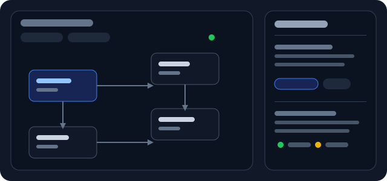

# 架构地图



给 DeepSeek Harness 的可交互、可寻址架构图。模型把节点、边和锚点写进唯一的 canonical 文件；右侧栏渲染图；每个节点都能开一个继承主对话记忆的隔离讨论。

## 功能

- **Canonical 图**：`.archmap/graph.json`，带 rev、schema 校验、原子写入和单步备份。
- **右侧栏画布**：分层 SVG 布局、边标签、`node.position` pin、平移/缩放/Fit、节点拖拽、Reset layout、节点详情。
- **架构记忆**：manifest、增量 `arch_sync`、代码/格式改动识别、stale 标记和 Markdown dossier（`overview`、`modules/<id>`、`notes/<id>`）。
- **按节点讨论**：`arch_discuss` 开 fork（继承已完成轮次）或 lite（只靠图和档案）；侧栏打开子会话；结论写到 `notes/<id>`。面板的 Discuss/Lite 会把当前选中的本地/远程来源传给 Host；远程讨论需要远程内容授权。
- **导出**：确定性的 Mermaid、SVG（跟随 position pin）、Markdown，落在 `.archmap/export/`。
- **内置 Mermaid**：assistant 消息里的 ` ```mermaid ` 用本插件自带的 runtime 渲染，不访问 CDN，不依赖额外 Mermaid 插件。
- **随包 skill**：`architecture-map` 指导 sync → 读变更 → 改图 → 档案 → commit 的循环。
- **远程 Linux 仓库（开发者预览）**：通过 SSH 登记仓库，不 clone；面板可切换本地/远程来源，读内容前要授权；60 秒指纹轮询把受影响节点标 stale，图和档案留在本地。

## 工具

| 工具 | 用途 |
| --- | --- |
| `arch_hello` | 诊断插件是否激活 |
| `arch_graph_get` / `arch_graph_patch` | 读图 / 批量改图（`apply:false` 只预览） |
| `arch_sync` | 全量或增量对比 workspace（`markStale` 可选） |
| `arch_manifest_commit` | 记录已分析文件 |
| `arch_doc_get` / `arch_doc_put` | 读写 dossier |
| `arch_discuss` | 开节点/边的 fork 或 lite 讨论 |
| `arch_export` | 导出 Mermaid/SVG/Markdown |
| `arch_remote_list` / `arch_remote_status` | 列远程项目；只读元数据，不需要授权 |
| `arch_remote_tree` / `arch_remote_read` / `arch_remote_grep` | 授权后只读查看远程内容 |

## 安装与启用

把 bundle 装进 DSH profile，启用 `architecture-map` 行。右侧栏会出现 **架构地图** tab。`/arch` 打开面板；节点详情有 `讨论（fork）` / `轻讨论`。用 `/arch remote add <id> <host> <path>` 登记远程，再在面板来源选择器里切换。

新会话里模型也会看到随包的 `architecture-map` skill。

## 配置

```yaml
- id: architecture-map
  name: dsh-architecture-map
  config:
    renderMermaid: auto
```

`renderMermaid: auto|on|off` 控制内置渲染。`auto` 在检测到已知冲突的 `dsh-mermaid-plus` 启用时关闭本插件渲染；`off` 时 fence 只显示代码块，也不加载 5.2 MB runtime。

## 数据与权限

- 本地状态只读写 `<workspace>/.archmap/`（以及浏览器本地的拖拽覆盖）。
- 无遥测、无外部网络请求；Mermaid 由插件自己的 Host 路由提供。
- 图和档案写入有上限、原子落盘；`arch_graph_patch` / `arch_doc_put` 不修改源码。
- 讨论子会话受提示词约束；shell 和通用源码写调用在执行层被拒绝（fork 可能仍显示继承的工具 schema）。
- 远程访问使用用户自己的 OpenSSH 配置，只读，不 clone、不写远程仓库；读内容需要显式授权：`/arch remote grant <id> session`（本次会话及子会话，仅内存）或 `/arch remote grant <id> always` / 不带范围（workspace，写进 `.archmap/index.json`，自动维护需要它）；`/arch remote revoke <id>` 两者都清。内容读取卡提供同样两个选择，面板来源条只显示写盘的 workspace 授权；远程路径逃逸和 root 外符号链接会被拒绝。
- Mermaid 使用 `securityLevel: 'strict'`。

## 已知限制

- 画布是手写 SVG，不是 React Flow。带环且没有 `position` pin 的图会退化为紧凑网格；在意阅读顺序时请 pin 布局。
- 分组只以节点副标题/详情显示；画布不画分组带，也不解析分组标题（0.4）。
- 拖动的节点位置只存在浏览器本地；`node.position` pin 存在图里。
- 右侧栏跟随**会话 workspace**；工具参数里的显式 `workspace` 不同时，面板不会显示那张图。
- fork 讨论会继承父对话 request prefix，工具列表里可能仍显示执行层已拒绝的 schema。
- 父 agent 用 `send_message` 继续子会话时，DSH 会在主对话里投递 settlement notice（含子会话 closing text）；初次 `arch_discuss` 是 caller-only，子会话 transcript 不会复制进主日志。
- Mermaid 布局使用默认 dagre；尚未提供布局选择器。
- 远程仓库是开发者预览：父会话空闲时自动维护不启动（用 `/arch remote update <id>` 手动兜底），维护后本地 pending 计数暂未清零。

## 第三方

- Mermaid 12.2.0（MIT）与 ELK/elkjs 0.9.3（EPL-2.0），vendored 在 `vendor/`。
- 静态路由/渲染方案参考 `dsh-mermaid-plus` 0.6.2（MIT）。
- 详见 `THIRD_PARTY_NOTICES.md` 和 `vendor/*.LICENSE`。

## 状态

0.3.0 开发者预览。`npm test` 覆盖图校验与位置、布局 pin 与连线路由、记忆、stale-hash、导出、远程内容/SSH、授权、同步、轮询、命令和维护策略（77 个测试）；CI 跑语法检查、测试和 `npm pack --dry-run`。
